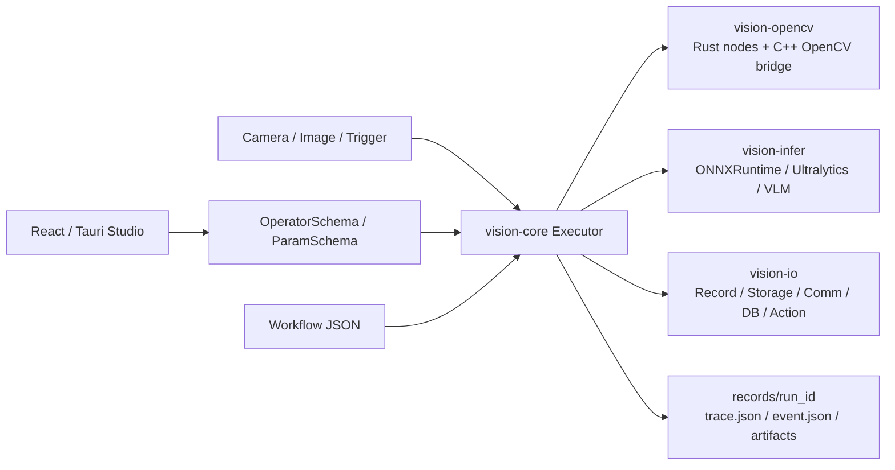
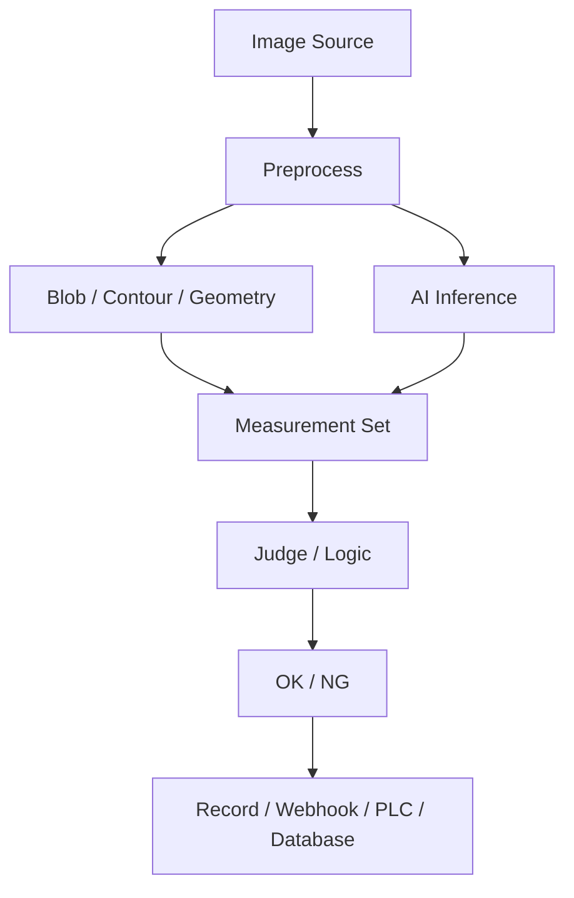

# OpenVisionForge

Rust-first open-source industrial vision inspection workflow platform.

[中文说明](README.zh-CN.md)

OpenVisionForge 是一个面向工业视觉检测的开源项目。它不是单个算法 demo，也不是只做拖拽 UI 的低代码玩具，而是一个以 Rust runtime 为核心的视觉检测底座：用节点描述采集、OpenCV 传统视觉、深度学习推理、测量、判定、记录、通讯和部署流程。

> Current status: early MVP. The architecture is already usable, but APIs, node schemas, UI layout, and deployment packaging may still change.

## Why OpenVisionForge

工业视觉项目通常不只缺一个算法。真正落地时还需要：

- 稳定的图像输入和触发机制。
- 可组合的传统视觉算子。
- 深度学习和 VLM 推理节点。
- 几何测量、阈值判断、OK/NG 输出。
- 运行记录、图像结果、trace、event、artifact。
- Webhook、PLC、消息队列、数据库、对象存储等外部系统对接。
- 可裁剪的小型 runtime，而不是部署一个臃肿开发环境。

OpenVisionForge 的目标是把这些能力组织成一个开源、可二次开发、可部署裁剪的工程平台。

## Screenshots

当前 UI 仍处于原型和 Studio 实现并行阶段。下面的截图来自现有 UI 原型，用于展示最终交互方向；实际运行中的 React/Tauri Studio 正在逐步对齐这个设计。


| 节点库 | 工作流画布 |
|---|---|
|  |  |

| 结果面板 | 实例属性 |
|---|---|
|  |  |

## Core Ideas

- **Rust-first runtime**: Rust 负责 workflow、节点注册、校验、执行、trace 和部署入口。
- **Schema-driven UI**: UI 不手写节点参数，而是读取 Rust 导出的 `OperatorSchema` / `ParamSchema`。
- **Workflow JSON as contract**: UI、CLI、runtime 都围绕同一份 workflow JSON 工作。
- **Operator-first architecture**: 每个能力都封装为 operator，方便组合、测试、裁剪和二次开发。
- **Small deployable runtime**: 开发期可以使用完整 Studio，部署期只打包 workflow 用到的节点、模型、DLL 和配置。
- **Open integration surface**: OpenCV、ONNX Runtime、TensorRT、RKNN、Sophon、PaddleOCR、SAM、VLM API 都可以作为后端或节点族接入。

## Architecture





## Workspace Layout

```text
crates/
  vision-core       Workflow, Value, OperatorSchema, Executor, validation, trace/event
  vision-opencv     OpenCV operator nodes and C++ OpenCV bridge
  vision-infer      ONNX Runtime, Ultralytics, Qwen VLM and future inference backends
  vision-io         Record, storage, communication, database and action nodes
  vision-operators  Built-in source, trigger, judge, logic and recipe nodes
  vision-runtime    Shared registry entry used by CLI and Studio
  vision-cli        Command-line runner and schema exporter

apps/
  vision-studio     React + Tauri workflow studio

examples/workflows  Example workflow JSON files
tools/              Smoke tests and helper scripts
docs/images         README screenshots and documentation assets
records/            Local runtime output; ignored for GitHub
models/             Local model files; ignored for GitHub
vendor/             Local SDK/vendor builds; ignored for GitHub
```

## Feature Overview

### Runtime

- Workflow / node / edge data model.
- DAG validation and execution.
- Runtime metrics: node duration, total duration, processed frames, FPS.
- `records/<run_id>/trace.json`.
- `records/<run_id>/event.json`.
- Artifact output for images, JSON, reports, and debug files.
- Rust-side validation is the final authority before execution.

### Studio UI

- React + Tauri desktop shell.
- Workflow canvas with nodes and edges.
- Collapsible node library.
- Node management page driven by Rust schema.
- Model, data, device, environment and settings pages.
- Workflow save/load as JSON.
- Rust validation result display.
- Node smoke status display.

### OpenCV Operators

Traditional vision nodes are implemented as Rust operators calling a local C++ OpenCV bridge. This keeps the workflow/runtime surface in Rust while still using OpenCV's mature implementation.

Current categories include:

- Image: read, write, clone, resize, crop.
- Color: grayscale and color conversion.
- Threshold: fixed, Otsu, triangle, adaptive, range.
- Filter: blur, Gaussian, median, sharpen.
- Enhance: gamma, histogram equalization, CLAHE, contrast stretch.
- Morphology: erode, dilate, open, close, gradient, top-hat, black-hat.
- Edge: Canny.
- Blob / contour: connected components, contour finding, filtering, area, roundness, aspect ratio, bounding rect, convex hull.
- Draw: boxes, contours, measurements, text.
- Geometry measurement:
  - `opencv.measure.point_distance`
  - `opencv.measure.point_line_distance`
  - `opencv.measure.line_width`
  - `opencv.measure.circle_diameter`
  - `opencv.measure.circle_center_distance`
  - `opencv.measure.angle`
  - `opencv.measure.parallelism`
  - `opencv.measure.perpendicularity`
  - `opencv.measure.concentricity`
  - `opencv.measure.area`
  - `opencv.measure.perimeter`
  - `opencv.measure.min_bounding_rect`
  - `opencv.measure.contour_size`
  - `opencv.measure.min_enclosing_circle`
  - `opencv.measure.fit_circle`
  - `opencv.measure.fit_line`
  - `opencv.measure.fit_ellipse`

### Inference Operators

The inference layer separates model family, model version, task, and backend:

```text
infer.<family>.<version>.<task>
```

Current or reserved families:

- ONNX Runtime generic runner.
- Ultralytics YOLO: detect, segment, classify, pose, OBB.
- Qwen VLM: describe, OCR, grounding, inspect.
- Reserved backend directions: TensorRT, RKNN, Sophon.
- Future node directions: PaddleOCR, SAM, open-vocabulary vision models.

Example:

```json
{
  "operator": "infer.ultralytics.yolo26.detect",
  "params": {
    "backend": "onnxruntime",
    "model_path": "models/yolo26.onnx",
    "input_width": 640,
    "input_height": 640,
    "score_threshold": 0.25
  }
}
```

### IO / Integration Nodes

OpenVisionForge is designed for production workflows, so result flow is a first-class part of the architecture:

- Record: manifest, JSON, trace, event.
- Storage: local, NAS, RustFS/S3-like object storage.
- Communication: webhook, WebSocket, HTTP, MQTT, Kafka, RabbitMQ, Redis.
- Database: MySQL, PostgreSQL, MongoDB, Milvus.
- Action: signal output, PLC write, alarm, robot call, camera trigger.

Some integration nodes are currently MVP/outbox/manifest style. Real SDK-backed implementations should be added behind feature flags or deployment profiles.

## Quick Start

### Requirements

- Windows 10/11 for the current OpenCV bridge build path.
- Rust stable toolchain.
- Node.js and npm.
- Visual Studio 2022 Build Tools or Community with MSVC C++ tools.
- OpenCV 5 build with `opencv_world500.lib` and `opencv_world500.dll`.

The OpenCV bridge looks for OpenCV in this order:

1. `OPENCV_DIR` environment variable.
2. `vendor/opencv5/opencv/build`.

For GitHub usage, do not commit the full `vendor/opencv5` directory. Prefer:

```powershell
$env:OPENCV_DIR="C:\path\to\opencv\build"
```

### Check the workspace

```powershell
cargo check
cargo test
```

### List operators

```powershell
cargo run -p vision-cli -- list-operators
cargo run -p vision-cli -- export-schema
```

### Run an example workflow

```powershell
cargo run -p vision-cli -- run examples/workflows/opencv_binary_ratio_demo.json
```

### Start Studio

```powershell
cd apps/vision-studio
npm install
npm run tauri:dev
```

Do not use plain Vite as the real runtime surface. The web UI calls Tauri commands that connect to Rust.

## Smoke Test

Node smoke tests generate minimal workflows for registered operators and verify that each node can run.

```powershell
powershell -ExecutionPolicy Bypass -File tools\node_smoke_test.ps1
powershell -ExecutionPolicy Bypass -File tools\node_smoke_test.ps1 -Filter "opencv.measure.fit_line"
powershell -ExecutionPolicy Bypass -File tools\node_smoke_test.ps1 -Filter "infer.ultralytics.*"
```

Reports are written to:

```text
records/<smoke_run>/node_smoke_results.csv
records/<smoke_run>/node_smoke_results.json
```

`records/` is local runtime output and should not be committed.

## Example Workflow Shape

```json
{
  "id": "binary_contour_measure_demo",
  "name": "binary_contour_measure_demo",
  "version": "0.1.0",
  "nodes": [
    { "id": "read", "operator": "opencv.image.read", "params": { "path": "demo/input/sample.jpg" } },
    { "id": "threshold", "operator": "opencv.threshold.otsu", "params": {} },
    { "id": "contours", "operator": "opencv.analysis.find_contours", "params": { "min_area": 10 } },
    { "id": "measure", "operator": "opencv.measure.area", "params": {} }
  ],
  "edges": [
    { "from_node": "read", "from_port": "image", "to_node": "threshold", "to_port": "image" },
    { "from_node": "threshold", "from_port": "image", "to_node": "contours", "to_port": "image" },
    { "from_node": "contours", "from_port": "contours", "to_node": "measure", "to_port": "contours" }
  ]
}
```

## Development Rules

- Add new runtime capability as an operator.
- Every operator must have stable id, category, inputs, outputs, params, and run function.
- UI should consume Rust-exported schema instead of duplicating node definitions.
- Rust validation is the source of truth.
- New OpenCV operators should have a Rust node file and bridge implementation when OpenCV is required.
- Every new operator should be smoke-testable.
- Deployment-specific SDKs should be optional, feature-gated, or plugin-like.

## Roadmap / TODO

### Core Runtime

- [x] Workflow / node / edge model.
- [x] Operator registry.
- [x] DAG execution.
- [x] Run trace and event output.
- [x] Node metrics and FPS.
- [x] Rust workflow validation.
- [ ] Versioned workflow schema.
- [ ] Recipe / job management for product variants.
- [ ] Sub-workflow / composite node support.
- [ ] Deployment manifest generation.

### OpenCV Operator Library

- [x] Image, color, threshold, filter, morphology, edge, transform nodes.
- [x] Blob and contour nodes.
- [x] Draw overlay nodes.
- [x] Geometry measurement MVP.
- [x] Min enclosing circle, fit circle, fit line, fit ellipse.
- [ ] ROI as a first-class value.
- [ ] Calibration and pixel-to-physical coordinate system.
- [ ] Contour point transport from bridge to Rust `ContourSet`.
- [ ] True upstream-contour geometry fitting without re-reading the image.
- [ ] More industrial caliper tools.

### Inference

- [x] ONNX Runtime runner surface.
- [x] Ultralytics YOLO node family.
- [x] Qwen VLM node family.
- [ ] Real YOLO decode completeness by task.
- [ ] TensorRT backend.
- [ ] RKNN backend.
- [ ] Sophon backend.
- [ ] PaddleOCR node family.
- [ ] SAM / segmentation prompt nodes.
- [ ] Model registry and model preset management.

### Studio UI

- [x] React/Tauri shell.
- [x] Workflow page.
- [x] Node library and node manager.
- [x] Save/load workflow JSON.
- [x] Rust validation integration.
- [x] Smoke status display.
- [ ] Full parity with UI prototype.
- [ ] Better connection editing and visual validation.
- [ ] Model manager parameter presets.
- [ ] Dataset manager and training page.
- [ ] Runtime artifact viewer.
- [ ] Deployment package wizard.

### Integrations

- [x] Record/storage/comm/db/action node surfaces.
- [x] Webhook demo.
- [ ] Real SDK-backed Kafka/MQTT/RabbitMQ/Redis modes.
- [ ] Real MySQL/PostgreSQL/MongoDB/Milvus client modes.
- [ ] RustFS/S3 object upload with production credentials handling.
- [ ] PLC and IO hardware adapters.

### Documentation

- [x] Project README.
- [ ] Operator reference generated from schema.
- [ ] Workflow schema reference.
- [ ] Developer guide for adding operators.
- [ ] Deployment guide.
- [ ] Architecture decision records.

## Comparison With Commercial Vision Platforms

OpenVisionForge is inspired by engineering ideas found in industrial vision tools such as VisionPro and VisionMaster:

- tool blocks / node composition,
- recipe-style workflow reuse,
- measurement plus OK/NG judgement,
- image result overlays,
- traceable inspection records.

The goal is not to clone closed-source commercial software. The goal is an open Rust-first foundation that developers can inspect, modify, extend, and deploy in small runtime packages.

## Suggested GitHub Repository Name

Recommended name:

```text
openvisionforge
```

Suggested description:

```text
Rust-first open-source industrial vision inspection workflow platform.
```

If `openvisionforge` is unavailable, good backups are:

- `openvisionforge-rs`
- `open-inspect-forge`
- `vision-inspect-forge`

## License

Recommended license for this project:

```text
MIT OR Apache-2.0
```

Choose one before public release, then add the corresponding `LICENSE` file.
