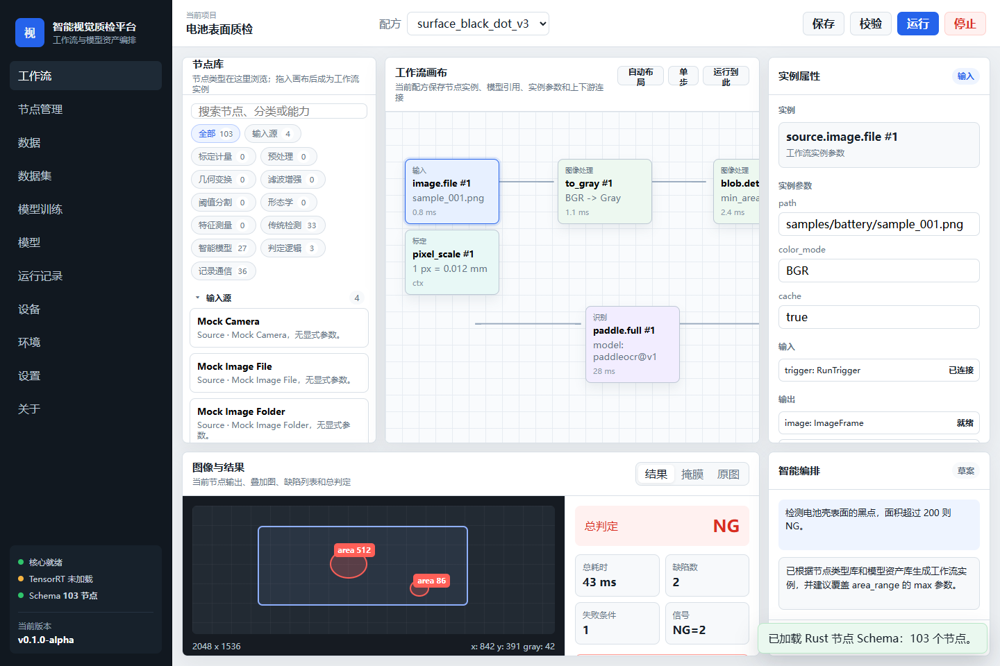
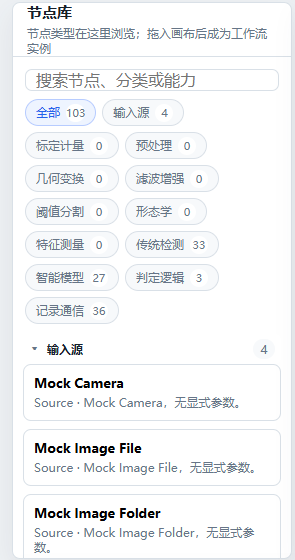
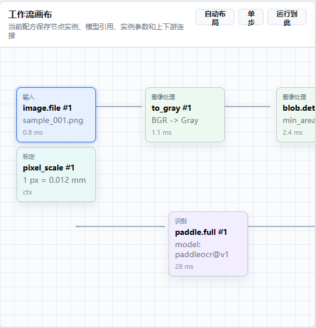
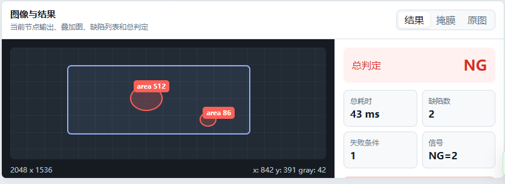
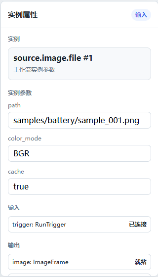
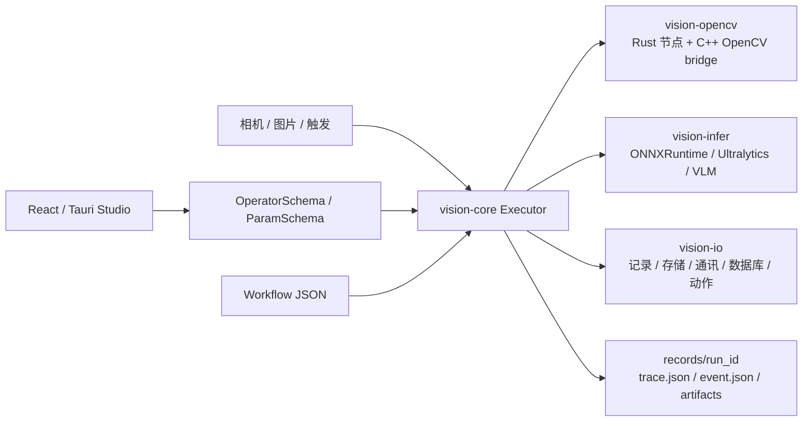
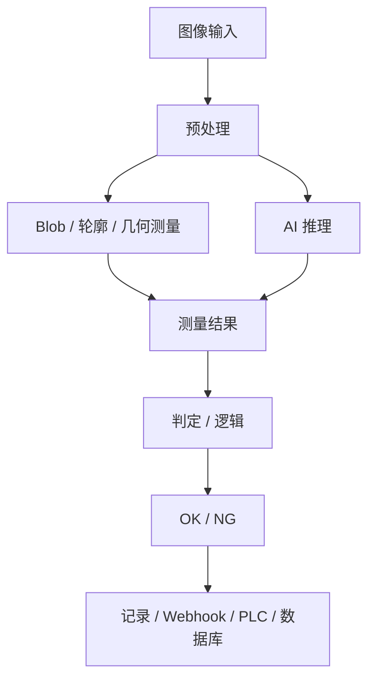

# OpenVisionForge 中文说明

OpenVisionForge 是一个 **Rust-first 的开源工业视觉检测工作流平台**。

它的目标不是做一个单独的算法 demo，也不是做一个只能拖拽配置的低代码工具，而是做一个可以长期扩展的工业视觉检测底座：用 Rust runtime 负责真正的 workflow 执行，用节点把图像输入、OpenCV 传统视觉、深度学习推理、几何测量、OK/NG 判定、记录、通讯和部署串起来。

> 当前状态：早期 MVP。核心架构已经能跑，节点体系、OpenCV bridge、ONNX/YOLO/VLM 方向、React/Tauri Studio 都已经建立，但 API、节点 schema、UI 和部署方式还会继续调整。

## 项目定位

工业视觉项目真正落地时，通常不只是缺一个算法。现场往往还需要：

- 图像采集、相机触发、光源控制。
- 传统视觉预处理、阈值、形态学、轮廓、Blob、几何测量。
- 深度学习目标检测、分割、分类、姿态、OCR、VLM。
- 多条件判断、短路判定、最终 OK/NG。
- 检测结果保存、叠加图保存、trace 记录、event 记录。
- Webhook、PLC、数据库、消息队列、对象存储、NAS 等外部系统对接。
- 开发时有 UI 辅助编排，部署时能生成较小的 runtime。

OpenVisionForge 想做的就是这一整套“工业视觉检测工程平台”的开源底座。

## 截图

当前 UI 仍处于原型和 React/Tauri Studio 实现并行阶段。下面截图展示的是目标交互方向。



| 节点库 | 工作流画布 |
|---|---|
|  |  |

| 结果面板 | 实例属性 |
|---|---|
|  |  |

## 核心设计原则

- **Rust-first**：Rust 是核心，负责 workflow、节点注册、校验、执行、trace 和部署。
- **Schema 驱动 UI**：UI 不重复维护节点定义，而是读取 Rust 导出的 `OperatorSchema` 和 `ParamSchema`。
- **Workflow JSON 是契约**：UI、CLI、runtime 都围绕同一份 workflow JSON 工作。
- **节点优先**：所有能力都以 operator/node 形式暴露，方便组合、测试、裁剪和二次开发。
- **开发和部署分离**：开发期可以使用完整 Studio，部署期只打包 workflow 用到的节点、模型、DLL 和配置。
- **开放式集成**：OpenCV、ONNX Runtime、TensorRT、RKNN、Sophon、PaddleOCR、SAM、VLM API 都可以作为节点或后端接入。

## 总体架构





## 目录结构

```text
crates/
  vision-core       workflow、Value、OperatorSchema、Executor、校验、trace/event
  vision-opencv     OpenCV 节点和 C++ OpenCV bridge
  vision-infer      ONNX Runtime、Ultralytics、Qwen VLM 和后续推理后端
  vision-io         记录、存储、通讯、数据库、动作输出节点
  vision-operators  内置 source、trigger、judge、logic、recipe 节点
  vision-runtime    CLI 和 Studio 共用的节点注册入口
  vision-cli        命令行运行器和 schema 导出工具

apps/
  vision-studio     React + Tauri 工作流 Studio

examples/workflows  示例 workflow JSON
tools/              smoke test 和辅助脚本
docs/images         README 图片资源
records/            本地运行输出，不提交 GitHub
models/             本地模型文件，不提交 GitHub
vendor/             本地 SDK/vendor 构建，不提交 GitHub
```

## 已完成能力

### Runtime 核心

- Workflow / WorkflowNode / WorkflowEdge。
- OperatorRegistry。
- DAG 校验和执行。
- 节点耗时、总耗时、处理帧数、FPS。
- `records/<run_id>/trace.json`。
- `records/<run_id>/event.json`。
- artifact 输出。
- Rust 端 workflow 校验。

### Studio UI

- React + Tauri 桌面壳。
- 工作流画布。
- 节点库。
- 节点管理。
- 模型、数据、设备、环境、设置等页面。
- workflow JSON 保存和加载。
- Rust 校验结果显示。
- 节点 smoke test 状态显示。

### OpenCV 节点

OpenCV 节点采用 “Rust operator + C++ OpenCV bridge” 的模式。Rust 负责节点 schema、参数、端口和 workflow；C++ bridge 调用 OpenCV 真实函数。

当前包含：

- 图像：读取、写入、复制、resize、crop。
- 色彩：灰度、颜色空间转换。
- 阈值：固定阈值、Otsu、Triangle、自适应阈值、范围阈值。
- 滤波：均值、高斯、中值、锐化。
- 增强：gamma、直方图均衡、CLAHE、对比度拉伸。
- 形态学：腐蚀、膨胀、开、闭、梯度、顶帽、黑帽。
- 边缘：Canny。
- Blob / 轮廓：连通域、轮廓查找、轮廓过滤、面积、圆度、长宽比、外接矩形、凸包。
- 绘制：框、轮廓、测量值、文本。
- 几何测量：
  - 点到点距离
  - 点到线距离
  - 线宽
  - 圆直径
  - 圆心距
  - 夹角
  - 平行度
  - 垂直度
  - 同心度
  - 面积
  - 周长
  - 最小外接矩形
  - 轮廓尺寸
  - 最小外接圆
  - 拟合圆
  - 拟合直线
  - 拟合椭圆

### 推理节点

推理层按照模型生态、模型版本、任务和后端拆分。

```text
infer.<模型生态>.<模型版本>.<任务>
```

已有或预留方向：

- ONNX Runtime 通用推理。
- Ultralytics YOLO：检测、分割、分类、姿态、OBB。
- Qwen VLM：图像描述、OCR、grounding、质检判断。
- TensorRT、RKNN、Sophon 后端预留。
- PaddleOCR、SAM、开放词表视觉模型后续接入。

示例：

```json
{
  "operator": "infer.ultralytics.yolo26.detect",
  "params": {
    "backend": "onnxruntime",
    "model_path": "models/yolo26.onnx",
    "input_width": 640,
    "input_height": 640,
    "score_threshold": 0.25
  }
}
```

### IO 和外部集成

OpenVisionForge 把结果流转也作为一等能力：

- Record：manifest、JSON、trace、event。
- Storage：local、NAS、RustFS/S3-like 对象存储。
- Communication：webhook、WebSocket、HTTP、MQTT、Kafka、RabbitMQ、Redis。
- Database：MySQL、PostgreSQL、MongoDB、Milvus。
- Action：信号输出、PLC 写入、报警、机器人调用、相机触发。

其中一部分节点当前还是 MVP/outbox/manifest 风格，后续会根据部署需要逐个接入真实 SDK。

## 快速开始

### 环境要求

当前 OpenCV bridge 的构建路径主要面向 Windows：

- Windows 10/11。
- Rust stable。
- Node.js 和 npm。
- Visual Studio 2022 Build Tools 或 Community，带 MSVC C++ 工具链。
- OpenCV 5，包含 `opencv_world500.lib` 和 `opencv_world500.dll`。

OpenCV 查找顺序：

1. `OPENCV_DIR` 环境变量。
2. `vendor/opencv5/opencv/build`。

建议 GitHub 仓库不要提交完整 `vendor/opencv5`，而是在本地配置：

```powershell
$env:OPENCV_DIR="C:\path\to\opencv\build"
```

### 检查项目

```powershell
cargo check
cargo test
```

### 查看节点

```powershell
cargo run -p vision-cli -- list-operators
cargo run -p vision-cli -- export-schema
```

### 运行示例 workflow

```powershell
cargo run -p vision-cli -- run examples/workflows/opencv_binary_ratio_demo.json
```

### 启动 Studio

```powershell
cd apps/vision-studio
npm install
npm run tauri:dev
```

注意：不要只用 Vite 网页作为完整运行环境。Studio 页面会调用 Tauri command 来连接 Rust runtime。

## Smoke Test

项目提供节点 smoke test 脚本，用来给每个 operator 生成最小 workflow 并验证能否运行。

```powershell
powershell -ExecutionPolicy Bypass -File tools\node_smoke_test.ps1
powershell -ExecutionPolicy Bypass -File tools\node_smoke_test.ps1 -Filter "opencv.measure.fit_line"
powershell -ExecutionPolicy Bypass -File tools\node_smoke_test.ps1 -Filter "infer.ultralytics.*"
```

输出位置：

```text
records/<smoke_run>/node_smoke_results.csv
records/<smoke_run>/node_smoke_results.json
```

`records/` 是本地运行输出，不应该提交。

## Workflow 示例

```json
{
  "id": "binary_contour_measure_demo",
  "name": "binary_contour_measure_demo",
  "version": "0.1.0",
  "nodes": [
    { "id": "read", "operator": "opencv.image.read", "params": { "path": "demo/input/sample.jpg" } },
    { "id": "threshold", "operator": "opencv.threshold.otsu", "params": {} },
    { "id": "contours", "operator": "opencv.analysis.find_contours", "params": { "min_area": 10 } },
    { "id": "measure", "operator": "opencv.measure.area", "params": {} }
  ],
  "edges": [
    { "from_node": "read", "from_port": "image", "to_node": "threshold", "to_port": "image" },
    { "from_node": "threshold", "from_port": "image", "to_node": "contours", "to_port": "image" },
    { "from_node": "contours", "from_port": "contours", "to_node": "measure", "to_port": "contours" }
  ]
}
```

## 开发规范

- 新能力优先做成 operator。
- 每个 operator 必须有稳定的 id、category、inputs、outputs、params 和 run 函数。
- UI 必须尽量消费 Rust 导出的 schema，不重复维护节点定义。
- Rust validation 是执行前的最终权威。
- OpenCV 算子应有 Rust 节点入口；需要 OpenCV 时再通过 bridge 调用。
- 新增 operator 应该能被 smoke test 覆盖。
- 部署相关 SDK 应通过 feature、插件或部署版本裁剪。

## Roadmap / TODO

### Core Runtime

- [x] Workflow / node / edge 模型。
- [x] Operator registry。
- [x] DAG 执行。
- [x] trace 和 event 输出。
- [x] 节点耗时和 FPS。
- [x] Rust workflow 校验。
- [ ] workflow schema 版本化。
- [ ] Recipe / Job 管理。
- [ ] 子流程 / 复合节点。
- [ ] deployment manifest 生成。

### OpenCV 算子库

- [x] 图像、色彩、阈值、滤波、形态学、边缘、变换节点。
- [x] Blob 和轮廓节点。
- [x] 绘制节点。
- [x] 几何测量 MVP。
- [x] 最小外接圆、拟合圆、拟合直线、拟合椭圆。
- [ ] ROI 成为一等数据类型。
- [ ] 标定和像素到物理单位坐标系。
- [ ] OpenCV bridge 返回轮廓点集。
- [ ] 基于上游 contours 的真实几何拟合。
- [ ] 更完整的工业 caliper 工具。

### 推理

- [x] ONNX Runtime runner 表面。
- [x] Ultralytics YOLO 节点族。
- [x] Qwen VLM 节点族。
- [ ] 按任务完善真实 YOLO decode。
- [ ] TensorRT 后端。
- [ ] RKNN 后端。
- [ ] Sophon 后端。
- [ ] PaddleOCR 节点族。
- [ ] SAM / 分割提示节点。
- [ ] 模型注册和模型参数预设。

### Studio UI

- [x] React/Tauri 壳。
- [x] 工作流页面。
- [x] 节点库和节点管理。
- [x] workflow JSON 保存和加载。
- [x] Rust 校验集成。
- [x] smoke 状态展示。
- [ ] 与 UI 原型完全对齐。
- [ ] 更好的连线编辑和可视化校验。
- [ ] 模型管理参数预设。
- [ ] 数据集管理和训练页面。
- [ ] artifact 查看器。
- [ ] 部署包生成向导。

### 外部集成

- [x] record/storage/comm/db/action 节点表面。
- [x] webhook demo。
- [ ] Kafka/MQTT/RabbitMQ/Redis 真实 SDK 模式。
- [ ] MySQL/PostgreSQL/MongoDB/Milvus 真实 client 模式。
- [ ] RustFS/S3 生产级对象上传。
- [ ] PLC 和 IO 硬件适配。

### 文档

- [x] 中文 README。
- [x] 英文/混合 README。
- [ ] 从 schema 自动生成 operator reference。
- [ ] workflow schema reference。
- [ ] 新增 operator 开发指南。
- [ ] 部署指南。
- [ ] 架构决策记录。

## 与 VisionPro / VisionMaster 的关系

OpenVisionForge 借鉴的是这类成熟工业视觉平台的工程思想：

- ToolBlock / 节点组合。
- Recipe / Job 复用。
- 测量值和 OK/NG 判定。
- 图像叠加结果。
- 可追溯运行记录。

但项目目标不是复制闭源商业软件，而是提供一个开源、Rust-first、可扩展、可二次开发、可裁剪部署的视觉检测平台底座。

## GitHub 仓库名建议

推荐：

```text
openvisionforge
```

如果已被占用，可以考虑：

- `openvisionforge-rs`
- `open-inspect-forge`
- `vision-inspect-forge`

建议 GitHub description：

```text
Rust-first open-source industrial vision inspection workflow platform.
```

## License

建议使用：

```text
MIT OR Apache-2.0
```

正式开源前需要补充对应的 `LICENSE` 文件。
